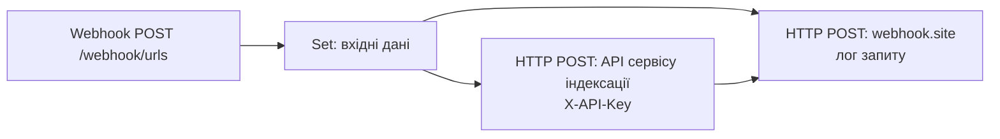
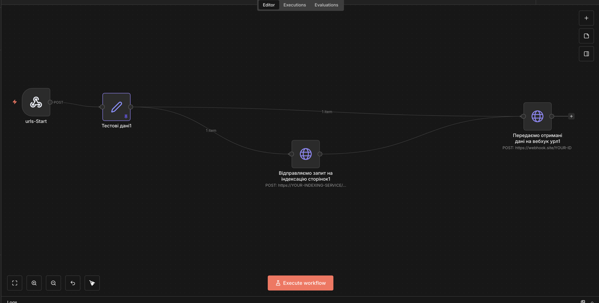
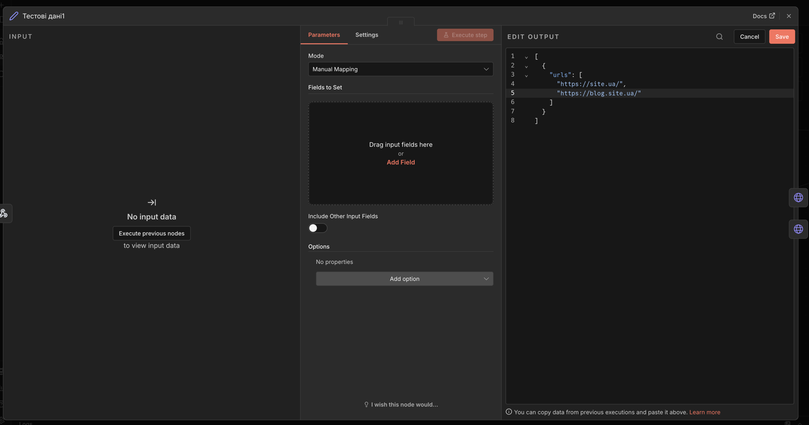
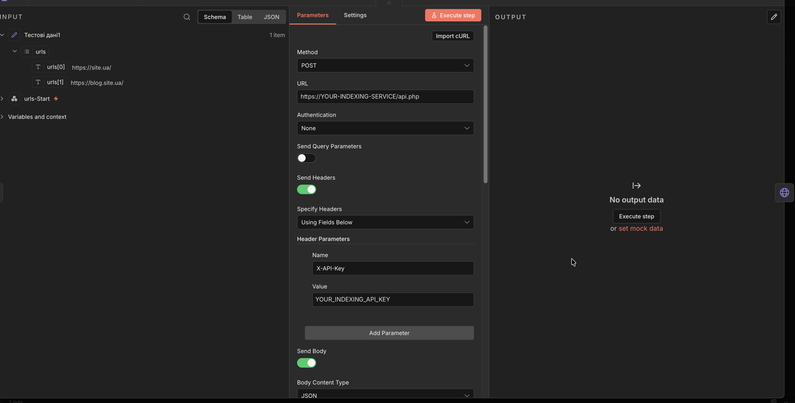
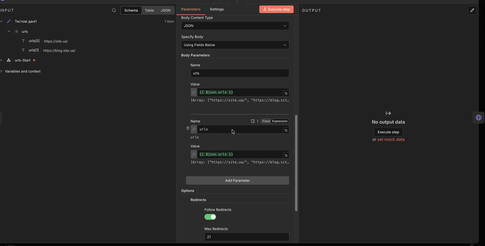
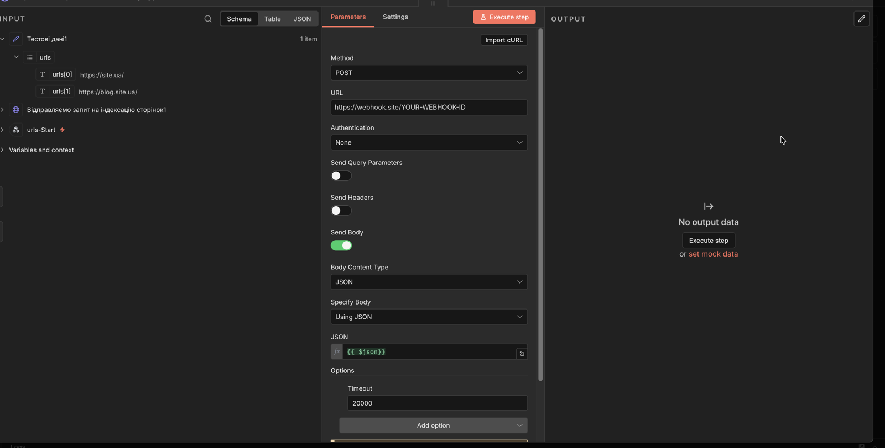

# 01 · Indexing — URL list

**Задача.** SEO-фахівцям потрібно швидко відправити нові або оновлені сторінки на індексацію в пошукові системи, не заходячи вручну в панель стороннього сервісу.

**Рішення.** Webhook приймає список URL у JSON, n8n відправляє його в API сервісу пришвидшеної індексації, а запит і відповідь сервісу пересилає на вебхук для логування й перевірки.





<details>
<summary>Налаштування вузлів (скріншоти)</summary>

**Тестові дані** — список URL у форматі, який приймає webhook:



**Запит на індексацію** — POST в API сервісу з ключем у заголовку `X-API-Key`:





**Лог** — запит і відповідь пересилаються на webhook.site для перевірки:



</details>

**Запуск:**

```bash
curl -X POST https://YOUR-N8N-DOMAIN/webhook/urls \
  -H "Content-Type: application/json" \
  -d '[{"urls": ["https://example.com/", "https://blog.example.com/"]}]'
```

**Що замінити:** `YOUR_INDEXING_API_KEY`, `https://YOUR-INDEXING-SERVICE/api.php`, `https://webhook.site/YOUR-WEBHOOK-ID`.

---

**EN.** A webhook accepts a JSON list of URLs; n8n submits it to a fast-indexing service API (X-API-Key) and forwards the request and the service response to a logging webhook. Replace the `YOUR_...` placeholders before use.
