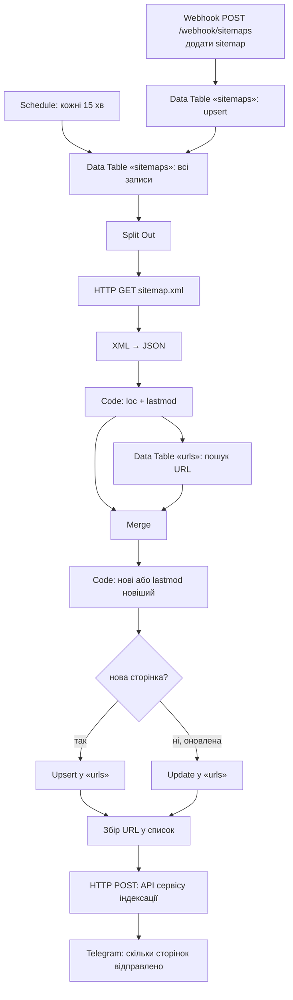
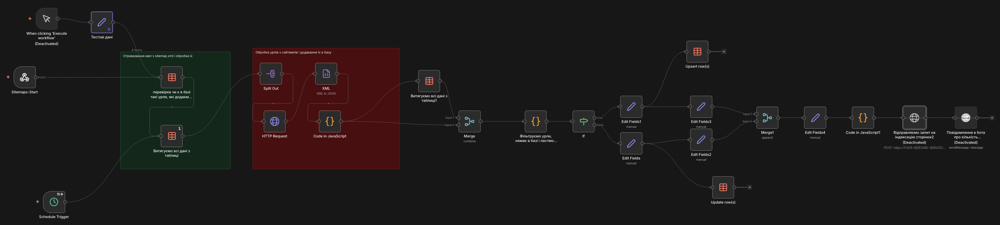

# 02 · Indexing — sitemaps monitor

**Задача.** На сайтах постійно з'являються нові сторінки й оновлюються старі. Відправляти на індексацію весь сайт щоразу дорого й неефективно, а вручну відстежувати зміни — довго.

**Рішення.** Workflow зберігає список sitemap.xml у таблиці n8n, кожні 15 хвилин читає їх, порівнює кожен URL і його `lastmod` з базою та відправляє на індексацію **лише нові або змінені** сторінки. Про кількість відправлених сторінок приходить повідомлення в Telegram.

## Як це виглядає в n8n

*Скрін широкий — клікни, щоб відкрити в повному розмірі.*

Зліва направо:
- **Три тригери:** ручний запуск із тестовими даними (вимкнений), webhook `Sitemaps-Start` для додавання нових sitemap і `Schedule Trigger`, що запускає перевірку кожні 15 хвилин.
- **Зелена зона — отримання sitemap.** Нові адреси sitemap записуються в таблицю `sitemaps` без дублікатів, потім із таблиці беруться всі sitemap для обробки.
- **Червона зона — обробка URL.** Кожен sitemap.xml завантажується, перетворюється з XML у JSON, а код витягує з нього пари `loc` + `lastmod`.
- **Порівняння з базою.** Дані з sitemap об'єднуються із записами таблиці `urls`, код відбирає нові сторінки та сторінки з новішим `lastmod`, вузол `If` розводить їх на дві гілки.
- **Запис і відправка.** Нові сторінки додаються в базу (`Upsert`), оновлені — оновлюються (`Update`). Обидві гілки збираються в один список URL, який іде в API індексації, а в Telegram приходить повідомлення про кількість. Останні два вузли в експорті вимкнені.

**Логіка порівняння** (вузол «Фільтруємо урли…»): URL нормалізується; якщо його нема в базі — `insert`, якщо `lastmod` у sitemap новіший, ніж у базі, — `update`; інакше сторінка пропускається.

**У цій версії** вузли відправки в API індексації та Telegram вимкнені (тестовий режим). Увімкни їх після налаштування ключів.

**Що замінити:** `YOUR_INDEXING_API_KEY`, `https://YOUR-INDEXING-SERVICE/api.php`, `YOUR_TELEGRAM_CHAT_ID`, ID таблиць (`YOUR_SITEMAPS_TABLE_ID`, `YOUR_URLS_TABLE_ID`) — створи в n8n дві Data Tables: `sitemaps` (колонка `urls`) і `urls` (колонки `loc`, `lastmod`).

---

**EN.** Stores sitemap URLs in an n8n Data Table, polls them every 15 minutes, compares each URL and its `lastmod` with the database and submits **only new or updated** pages to the indexing API, then reports the count to Telegram. Indexing and Telegram nodes are disabled in this export (test mode).
