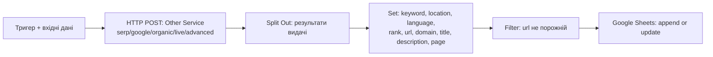
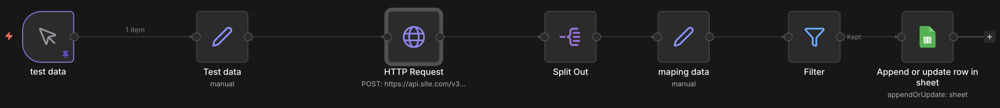

# 03 · SERP positions → Google Sheets

**Задача.** Регулярно знати, на яких позиціях у Google стоять сторінки сайту за потрібними запитами, з урахуванням країни, мови та пристрою.

**Рішення.** Workflow отримує параметри запиту, звертається до Other Service API (Google organic, live), розбирає видачу, залишає органічні результати з URL і записує їх у Google Sheets. На основі цього флоу зробили сервіс збору позицій.



## Як це виглядає в n8n



Зліва направо:

- **test data / Test data** — ручний запуск із закріпленими тестовими параметрами запиту; вузол `Set` передає їх далі у потрібному форматі.
- **HTTP Request** — POST у Other Service API: Google, органічна видача, режим live.
- **Split Out** — розбиває відповідь API на окремі результати видачі.
- **maping data** — залишає потрібні поля: запит, країна, мова, позиція, URL, домен, title, description, сторінка видачі.
- **Filter** — пропускає далі лише результати з URL (без блоків видачі без посилань).
- **Append or update row in sheet** — записує результати в Google Sheets.

**Вхідні дані:**

```json
[{ "keyword": "example keyword", "location_code": 2792, "language_code": "tr",
   "device": "mobile", "os": "android", "depth": 100, "max_crawl_pages": 10, "se_type": "organic" }]
```

Тригер можна замінити на будь-яке джерело, яке віддає дані в такому форматі (Google Sheets зі списком запитів, webhook, розклад).

**Що замінити:** заголовок `Authorization: Basic YOUR_BASE64(login:password)` для DataForSEO, `YOUR_SPREADSHEET_ID`, credentials Google Sheets.

---

**EN.** Takes query parameters (keyword, location, language, device), calls the Other Service API (Google organic, live), extracts organic results with URLs and writes rank, URL, domain, title and description to Google Sheets. A rank-tracking service was built on top of this flow.
